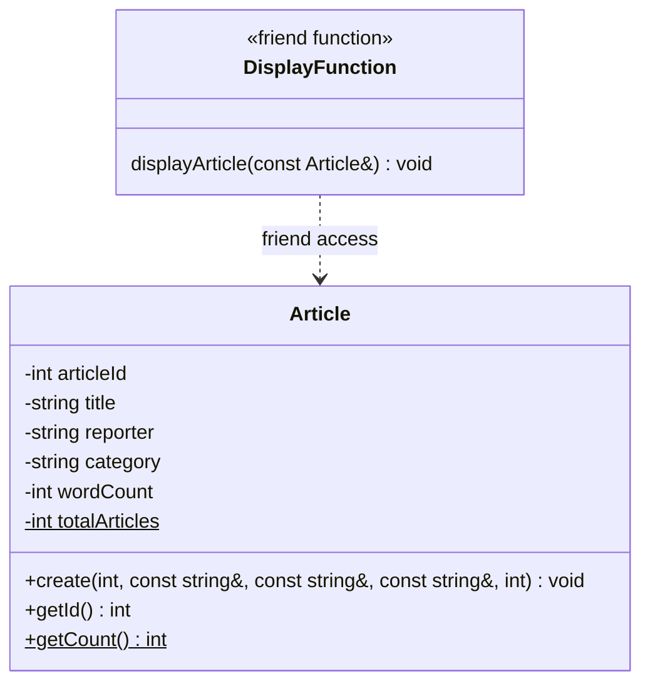
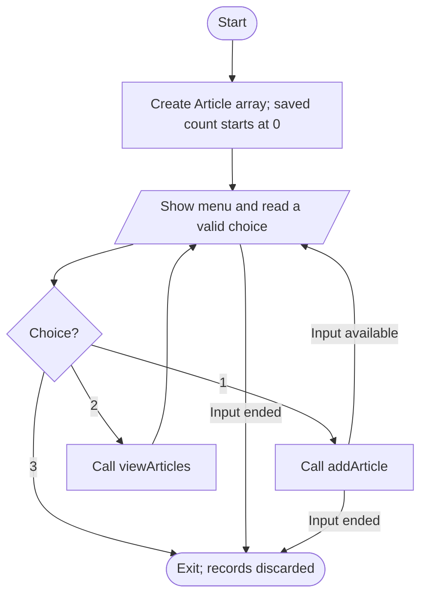
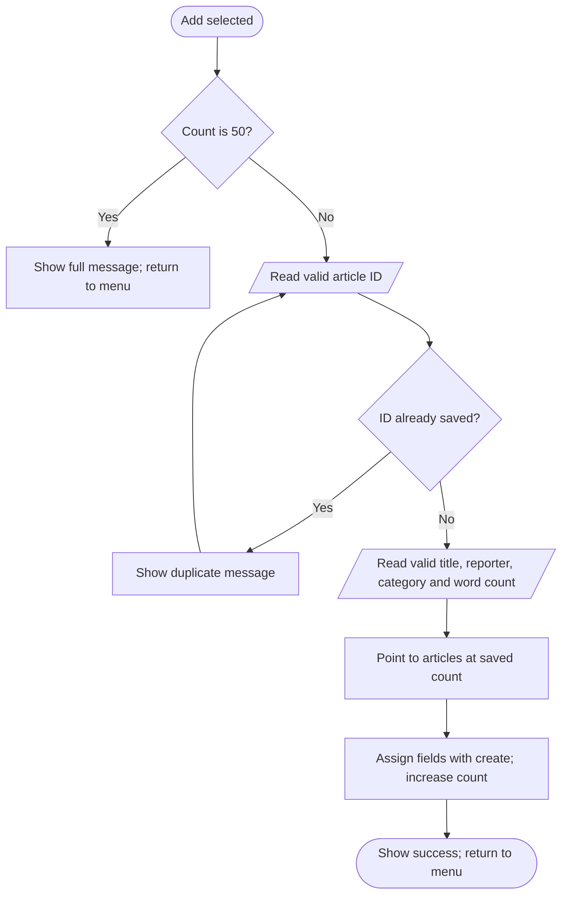

# Community Newspaper Editorial Desk

## CA 1: Design and Create

CAP455 - Object Oriented Programming using C++  
Master of Computer Applications | Session 2026-27

| Student detail | Value |
| --- | --- |
| Name | Himanshu Gupta |
| Registration number | 12602516 |
| Roll number | 52 |
| Section | D1P2635 |
| Allocated theme | Community Newspaper Editorial Desk |
| Main entity / unique key | Article / articleId |

## Proposal overview

This project provides a small console application for recording article details at a community newspaper. CA 1 demonstrates in-memory Create and Read operations using one class, a fixed array of objects, pointers, strings and input validation. The implementation accompanies this design proposal.

## Document map

2. Problem and objectives
3. Scope and requirements
4. Data dictionary
5. UML class design
6. Main program flow
7. Article creation flow
8. C++ concepts and dry run
9. Testing and demonstration
10. Phase plan, standards and references

<!-- PAGE -->

# Problem and objectives

## Problem statement

A community newspaper receives articles from different reporters about local news, education and events. The editor needs a clear record of each submission's title, reporter, category and word count. Loose notes can make it difficult to identify records consistently or review all submitted items together.

The proposed application assigns a unique numeric ID to each saved article record. The editor enters the article details through a console menu and views the saved list when needed. Duplicate IDs and invalid input are rejected before a record is stored.

## Intended user and main entity

The user is an editor operating the program on one computer. The main entity is an Article. Each object describes one article submission. A reporter is stored as a name within that record; CA 1 does not need a separate Reporter class or login system.

## Objectives

- Create a record with a unique article ID and valid descriptive fields.
- Display all saved records in entry order, including a total count.
- Keep related article data private within a class.
- Demonstrate static members, an inline accessor and a friend function.
- Use an array of objects, an object pointer, the this pointer and standard strings.

## Example use

An editor records ID 101 for "Cleanliness Drive in Sector 4", reported by Neha Sharma, in Local News, with a word count of 350. A later attempt to reuse 101 is rejected. The editor can enter 102 for a different submission and view both records.

## Expected outcome

The CA 1 version demonstrates a working article register. It establishes the entity and validation rules for later persistence, search, update and delete features. It does not publish a newspaper or manage the article's full text.

<!-- PAGE -->

# Scope and requirements

## Functional requirements

| Ref. | Requirement | Acceptance condition |
| --- | --- | --- |
| F1 | Add an article | Five valid fields are saved in the next unused slot |
| F2 | Prevent duplicate keys | An existing articleId is rejected before other fields are saved |
| F3 | View all articles | Every saved record is displayed once in entry order |
| F4 | Show empty state | View reports that no articles are available when count is zero |
| F5 | Validate input | Invalid values cause a clear message and another prompt |
| F6 | Enforce capacity | A 51st addition is refused without accessing beyond the array |
| F7 | Exit cleanly | The menu ends and in-memory records are discarded |

## Proposed design choices

The capacity is 50 articles. IDs range from 1 to 9999. Titles allow 1-80 characters and reporter names 1-40 characters after removing outer whitespace. Word counts range from 1 to 5000. Categories are Local News, Education and Events. These limits are project design choices, not limits mandated by the guide.

## CA 1 boundaries

Data remains in memory for the current run. There is no disk persistence, dedicated search menu, update, deletion, inheritance or custom exception handling in this phase. Duplicate detection scans IDs internally; this does not constitute the separate record-search feature planned for CA 2.

The editor supplies word count as metadata. Automatic counting would require the full article text. The application has one user and a text menu. It needs a standard C++11 compiler and no third-party libraries.

## Reliability requirements

All input is read as complete lines. Numeric input must contain exactly one integer within range. A record is committed only after every field is valid. If input ends early, the incomplete record is discarded. Display and duplicate checking only inspect saved slots, never unused array elements.

<!-- PAGE -->

# Data dictionary

## Article fields

| Field | C++ type | Meaning and validation | Example |
| --- | --- | --- | --- |
| articleId | int | Unique key; 1-9999; no duplicate among saved records | 101 |
| title | std::string | Article headline; 1-80 characters after trimming | Cleanliness Drive in Sector 4 |
| reporter | std::string | Reporter name; 1-40 characters after trimming | Neha Sharma |
| category | std::string | Local News, Education or Events; selected using 1-3 | Local News |
| wordCount | int | Editor-entered length of the article; 1-5000 | 350 |
| totalArticles | static int | Shared count of saved records; 0-50; not part of one article | 1 |

## Supporting program data

| Name | Type / role | Meaning |
| --- | --- | --- |
| MAX_ARTICLES | const int | Capacity of the object array; value 50 |
| articles | Article[50] | Main program's fixed storage for article objects |
| current | Article* | Address of the next unused slot during a successful addition |
| choice | int | Menu option: Add, View or Exit |
| duplicate | bool | Whether the entered ID matches an existing saved record |

## Key and storage rules

The ID identifies a record independently of its title or reporter. Two articles may have the same title; they must have different IDs. IDs are numeric, so 00101 and 101 represent the same key.

The array indexes run from 0 to 49. With a saved count of n, indexes 0 through n-1 hold records and index n is the next free slot if n is below 50. The capacity check happens before that slot is accessed.

Text keeps internal spaces and removes outer spaces or tabs. The supplied examples use plain English text. Standard string length measures bytes, so the limits are not a Unicode-character counting feature.

<!-- PAGE -->

# UML class design

## Main class and friend relationship

## Interpretation

The minus sign denotes private data and the plus sign public operations. Underlined members in the PDF diagram are static. getId() is an inline, const accessor. getCount() is static. The create() parameters correspond, in order, to articleId, title, reporter, category and wordCount.

The display box represents an ordinary non-member function, not a second C++ class. The class declares it as a friend so it can display private fields. It takes a const reference and does not modify or copy the article.

## Responsibilities

Article holds one record and assigns its fields. main() owns the array and menu. addArticle() performs validation and duplicate checking before calling create() on an unused object. viewArticles() loops over saved records and calls the friend function.

create() is a normal member function with return type void, not a constructor. Its CA 1 contract is to initialise an unused slot once and then increase the saved count. An update feature in a later phase must use different logic that preserves the count.

<!-- PAGE -->

# Main program flow

## Menu behaviour

readInt() retries blank, non-numeric, fractional, mixed and out-of-range menu input. Choice 1 calls addArticle(). Choice 2 displays records or a clear empty-list message. Choice 3 leaves the loop. Input ending also stops the program cleanly.

## Read algorithm

1. If the saved count is zero, display "No articles available" and return.
2. Display the saved count.
3. Loop from index 0 while the index is less than the saved count.
4. Call displayArticle() for that object and return to the menu after the loop.

Only saved records are read. Viewing never changes a field or the record count. Records remain in their original entry order.

<!-- PAGE -->

# Article creation flow

## Validation and commit

Each input helper retries its own invalid field. The ID loop scans existing records and retries duplicates. No partial Article is saved while local input variables are being collected. If input ends at any prompt, addArticle() returns false and main() closes without saving the incomplete record.

The pointer is taken only after all input has passed. For the first record it points to articles[0]. create() uses this to assign the object's members, then increases totalArticles by one. The success message appears only after this operation.

<!-- PAGE -->

# C++ concepts and dry run

## Mapping to CA 1 requirements

| Concept | Concrete use | Explanation |
| --- | --- | --- |
| Class / encapsulation | Article; private fields | Keep one article's data together |
| Static member | totalArticles | Share the saved-record count across the class |
| Static function | Article::getCount() | Read the count without choosing an object |
| Inline function | getId() const | Small read-only ID accessor; inlining is not guaranteed |
| Friend function | displayArticle() | Non-member function can read private fields |
| Array of objects | Article articles[50] | Fixed storage for the records |
| Object pointer | Article* current | Refer to the next free slot using its address |
| this pointer | this->title = title | Distinguish the current field from a parameter |
| Strings / references | string fields; const references | Store text with spaces and avoid unnecessary copies |

## Dry run

| Action | Array / count result |
| --- | --- |
| Start program | 50 slots exist; saved count is 0 |
| Add valid ID 101 | articles[0] gets the fields; count becomes 1 |
| Attempt ID 101 again | Duplicate detected; no new record and count stays 1 |
| Retry with valid ID 102 | articles[1] gets the fields; count becomes 2 |
| View all | Display indexes 0 and 1; count stays 2 |
| Exit and restart | New run starts with saved count 0 |

## Simplicity and cost

Duplicate checking visits at most n saved records, so it is O(n). Display is also O(n). With at most 50 records, these loops are adequate. The fixed array owns the objects, so the object pointer requires no manual allocation or deletion. Standard strings manage their own internal text storage.

<!-- PAGE -->

# Testing and demonstration

## Verification completed

The C++ source compiled on Windows with MinGW GCC 6.3.0 using -std=c++11 -Wall -Wextra -pedantic, with no warnings or errors. On 2 November 2026, the test runner executed 19 black-box tests successfully against the compiled application.

| Test group | Evidence checked | Result |
| --- | --- | --- |
| Normal use | Empty list; successful add/read; all categories; repeated view | Passed |
| Key validation | Duplicate retry; invalid and boundary IDs | Passed |
| Numeric input | Blank, letters, decimals, mixed input, overflow and range limits | Passed |
| Text input | Blank text, whitespace-only text, outer trimming and length boundaries | Passed |
| Capacity | 50 successful additions; next addition refused; 50 records still displayed | Passed |
| Lifetime / interruption | Restart clears records; input ending does not save a partial record | Passed |
| Supplied demo | Sample input produces duplicate warning and two displayed articles | Passed |

The tests folder includes the detailed table, executable test script and captured test results. The data folder includes sample keyboard input and the actual captured application output. These are supporting evidence, not application persistence files.

## Live demonstration sequence

1. Start the application and View to show the empty state.
2. Add article 101, Cleanliness Drive in Sector 4, Neha Sharma, Local News, 350 words.
3. Start another addition and enter 101 to show duplicate rejection.
4. Retry with 102, School Science Exhibition, Aman Verma, Education, 600 words.
5. View both articles and explain the saved count and array indexes.
6. Show the class, friend function, inline accessor, object pointer and this assignments.
7. Exit and restart to demonstrate that CA 1 data is temporary.

Student rehearsal and an individual live viva are still required. Automated checks demonstrate program behaviour; they do not demonstrate the student's understanding.

<!-- PAGE -->

# Phase plan, standards and references

## Development roadmap

| Phase / due from allocation | Planned work |
| --- | --- |
| CA 1 / day 7 | Current implementation: entity design, Create/Read, validation, array, pointers and documentation |
| CA 2 / day 14 | Default, parameterised and copy constructors; destructor; binary fixed-size records; seekg search and seekp update |
| CA 3 / day 28 | Base and at least two derived classes; overload <<, >>, ==, < and one more operator; one conversion; new/delete; virtual functions and destructor; confirmed update/delete |
| CA 4 / day 42 | Full CRUD; try/catch/throw and custom exception; function/class templates; vector/list with sort, find_if and count_if; CSV export |

Later-phase features are planned, not implemented. A separate fixed-size record representation will be needed for binary storage; an Article containing std::string must not simply be dumped as raw object bytes. Each phase should address faculty feedback and be recorded through meaningful Git commits.

## Technical implementation and standards

The implementation strictly adheres to standard C++11 specifications using core standard library headers (`<iostream>`, `<string>`, `<sstream>`). Robust encapsulation is enforced through private member fields, validated accessors, and const references for non-modifying routines. Data integrity is maintained with boundary validation, input trimming, and unique key checks.

## Academic references

1. Bjarne Stroustrup, *The C++ Programming Language*, 4th Edition, Addison-Wesley, 2013.
2. Robert Lafore, *Object-Oriented Programming in C++*, 4th Edition, Sams Publishing, 2002.
3. Nicolai M. Josuttis, *The C++ Standard Library*, 2nd Edition, Addison-Wesley, 2012.
4. ISO/IEC 14882:2011 - Programming Languages - C++ (C++11 Standard).
